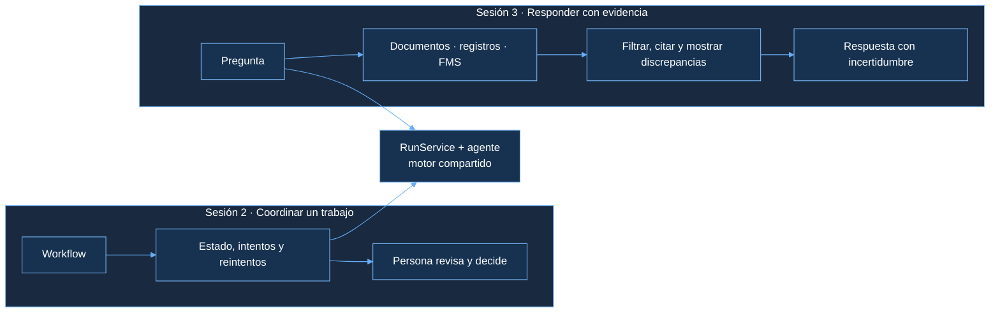
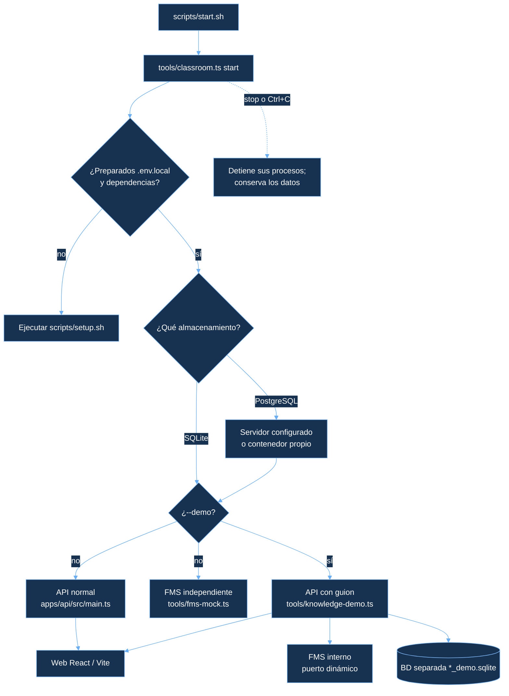
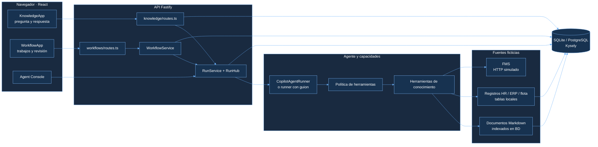
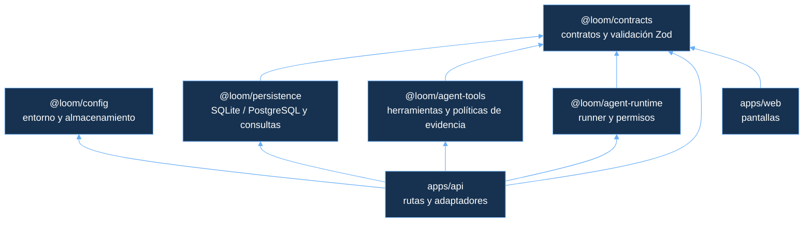
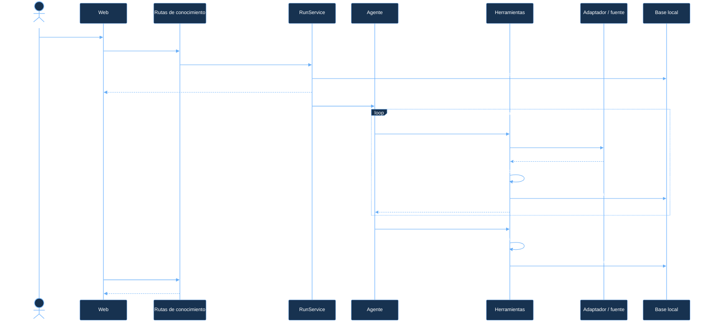
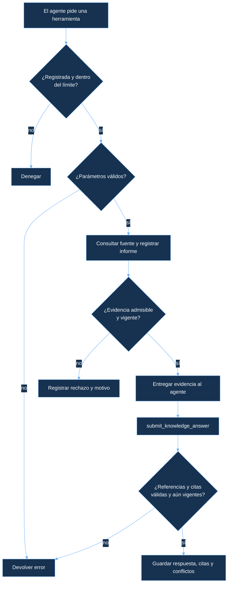
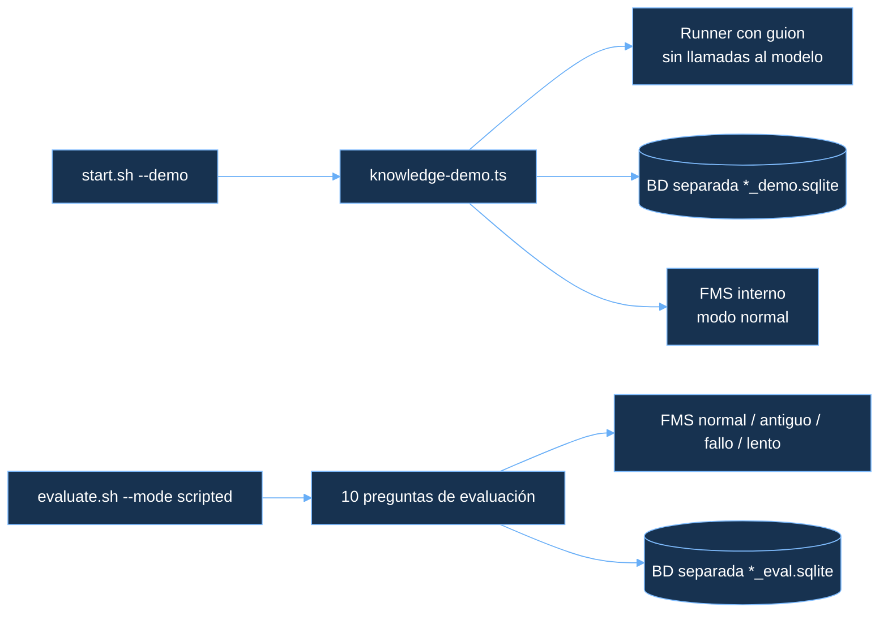

# Arquitectura de Loom · Sesión 3 y evolución desde la sesión 2

Este documento describe la **aplicación de la sesión 3** que arranca con `bash scripts/start.sh`: una web para hacer preguntas sobre FruitTrucks y recibir respuestas con evidencia. Incluye el recorrido que se conserva de la sesión 2, qué se añade ahora y dónde encaja cada taller.

> 💬 «En la sesión 2 Loom coordinaba un trabajo y su revisión humana. En la sesión 3, además, el agente puede consultar fuentes distintas y entregar una respuesta con citas. Ambos recorridos comparten el motor de ejecuciones.»

Esta guía es una referencia para seguir la arquitectura y los talleres. Las rutas enlazadas son relativas a la carpeta donde has extraído el ZIP.

Los diagramas muestran el comportamiento de la **demo completa**. El ZIP de alumnos contiene la misma estructura, pero deja cuatro piezas pendientes: se indican en el apartado 8.

## 1. Qué cambia de la sesión 2 a la 3

| Sesión 2: se conserva | Sesión 3: se añade |
| --- | --- |
| Web React/Vite y API Fastify | Pantalla **Knowledge access** y rutas de conocimiento |
| `RunService`, Copilot SDK y herramientas controladas | Instrucciones y herramientas para buscar y entregar evidencia |
| Workflows, historial, reintentos y revisión humana | Tres familias de fuentes y adaptadores de consulta |
| Persistencia de ejecuciones y workflows | Informes de recuperación, citas, conflictos y respuesta de conocimiento |
| SQLite como opción local; PostgreSQL opcional | Búsqueda documental y tablas de conocimiento también disponibles en SQLite |

La consulta de conocimiento **no pasa por `WorkflowService`**. Ambos recorridos comparten `RunService` y el límite de una ejecución activa. Una respuesta de conocimiento no acepta un workflow.

## 2. Qué arranca `scripts/start.sh`

| Componente | Dirección habitual en una instalación nueva | Código |
| --- | --- | --- |
| Web | `LOOM_WEB_PORT`, normalmente `5173` | [apps/web](apps/web/src/main.tsx) |
| API | `LOOM_API_PORT`, normalmente `3000` | [apps/api](apps/api/src/server.ts) |
| Base | SQLite: `.loom/session-03.sqlite` por defecto; PostgreSQL es opcional | [configuración](packages/config/src/index.ts) y [persistencia](packages/persistence/src/database.ts) |
| FMS normal | `LOOM_FMS_URL`, normalmente `http://127.0.0.1:3010` | [fms-mock.ts](tools/fms-mock.ts) |

Los puertos se pueden cambiar durante `setup`. Con `--demo`, el FMS se crea dentro del proceso de demo en un **puerto dinámico**. La demo usa preguntas exactas preparadas y no llama al modelo. El arranque normal utiliza Copilot.

## 3. Componentes y fuentes

La web de conocimiento muestra respuesta, citas y **Source access**. Cada bloque de Source access representa **una consulta a un adaptador**: pueden aparecer dos bloques `documents` si el agente busca dos veces, incluso si ambas búsquedas encuentran el mismo documento.

Los documentos y los registros están cargados en la base local mediante `seedKnowledge`. FMS es un servidor HTTP simulado que responde a `GET /vehicles/:vehicleId`; no es un sistema corporativo conectado.

## 4. Paquetes y API

| Ruta HTTP | Función |
| --- | --- |
| `POST /api/knowledge` | Inicia una pregunta; devuelve `202` y el identificador del run. |
| `GET /api/knowledge` / `GET /api/knowledge/:id` | Lista consultas o recupera respuesta e informes de fuentes. |
| `/api/agent-runs/:id` y `/events` | Estado de ejecución y eventos SSE; la traza detallada puede caducar de memoria. |
| `/api/workflows` y `/api/workflows/:id` | Conservan el recorrido de la sesión 2. |
| `POST /api/workflows/:id/accept` o `/reject` | Decisión de revisión humana del workflow. |
| `GET /api/health` | Estado de la API y conexión de almacenamiento. |

Las rutas concretas están en [knowledge/routes.ts](apps/api/src/knowledge/routes.ts), [runs/routes.ts](apps/api/src/runs/routes.ts) y [workflows/routes.ts](apps/api/src/workflows/routes.ts).

## 5. Recorrido de una pregunta

**Antes de los talleres**, algunas reglas de este recorrido están pendientes. En particular, el modelo puede describir una discrepancia en su texto aunque la detección estructurada de Loom esté sin implementar; esa detección es el taller 3.

## 6. Datos y persistencia

| Fuente o resultado | Dónde verlo | Ejemplo |
| --- | --- | --- |
| Documentos | [examples/session-03](examples/session-03/knowledge-seed.json); se cargan en `knowledge_documents` y el índice de búsqueda | [Manual](examples/session-03/operations-manual.md) y [entrevista](examples/session-03/dispatcher-interview.md) |
| HR | `knowledge_drivers` + `knowledge_licences` | D-101 y permiso C1 |
| ERP | `knowledge_locations` + `knowledge_customers` | LOC-SM1: 60 minutos en ERP; 30 en el acuerdo |
| Registro técnico | `knowledge_vehicles` | FT-V-001: permiso requerido y carga |
| FMS | [fms-fixtures.json](examples/session-03/fms-fixtures.json) y [mock.ts](apps/api/src/knowledge/mock.ts) | FT-V-001: disponible y 5 °C |
| Consulta y respuesta | `knowledge_queries` y `agent_runs` | Informes de cada búsqueda, respuesta y citas |

Los registros de ejemplo están en [knowledge-seed.json](examples/session-03/knowledge-seed.json). [sqlite-migrations.ts](packages/persistence/src/sqlite-migrations.ts) define las tablas y el índice FTS de SQLite; [knowledge.ts](packages/persistence/src/knowledge.ts) carga y consulta los datos.

## 7. Controles: herramienta, evidencia y respuesta

- **Herramientas:** el runner permite las registradas y aplica un presupuesto de 12 llamadas. No ofrece SQL, URLs arbitrarias ni decisiones humanas como herramientas.
- **Evidencia:** en la solución se rechazan fuentes no verificadas, fechas inválidas o demasiado futuras y datos caducados. Límites: documentos **365 días**, registros **7 días** y FMS **120 segundos**.
- **Respuesta:** las citas deben pertenecer a evidencia admitida en esa ejecución y corresponder a su texto. Si no hay evidencia, se puede guardar incertidumbre sin inventar una respuesta.
- **Conflictos:** se comparan hechos estructurados con la misma clave entre fuentes distintas. Se conservan valores y referencias; Loom no decide automáticamente cuál es correcto.

Una cita indica procedencia; por sí sola no garantiza que la interpretación del modelo sea correcta. El historial de consulta y respuesta se guarda; la traza detallada de eventos tiene una vida limitada en memoria.

## 8. Dónde actúa cada taller

| Taller | Pieza pendiente en el ZIP inicial | Resultado al terminar |
| --- | --- | --- |
| **1 · Registros** | `lookupKnowledgeRecords` en [knowledge.ts](packages/persistence/src/knowledge.ts) | Busca por ID y une conductor-permiso y ubicación-cliente. |
| **2 · Autoridad y vigencia** | `rejectionReason` en [policy.ts](packages/agent-tools/src/knowledge/policy.ts) | Rechaza evidencia no admisible al recuperar y al entregar. |
| **3 · Conflictos** | `detectKnowledgeConflicts` en [policy.ts](packages/agent-tools/src/knowledge/policy.ts) | Detecta valores distintos y conserva las referencias. |
| **4 · Flota** | Registro de `get_vehicle_status` en `createKnowledgeTools`, [tools.ts](packages/agent-tools/src/knowledge/tools.ts) | Conecta la herramienta al FMS; el adaptador y el servidor simulado ya existen. |

Las rutas de la tabla apuntan a los archivos de tu proyecto. En el ZIP inicial encontrarás los huecos pendientes; irás completándolos en cada taller.

## 9. Modo demo y evaluación

La demo con guion utiliza las preguntas exactas de [questions.json](examples/session-03/questions.json). La evaluación scripted comprueba el circuito con diez casos sin llamar al modelo; no mide la calidad de selección de herramientas de Copilot. El modo `live` usa Copilot y su cuota.
