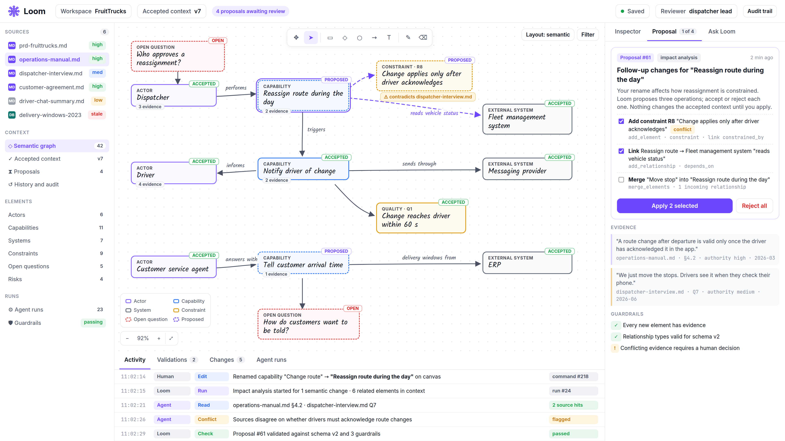

# Sesión 3 — Dar a Loom conocimiento que pueda explicar

Esta lectura explica por qué Loom necesita distintos tipos de información, cómo debe utilizarla un agente y qué aportan los cuatro talleres. Léela antes de la sesión para situarte y vuelve a ella después para relacionar los ejercicios con el conjunto del proyecto. Los pasos prácticos están en la [guía de talleres](WORKSHOP.md).

## ¿Qué queremos conseguir?

El objetivo del campus es desarrollar un equipo capaz de **diseñar e implementar una aplicación agéntica**: software en el que la IA pueda interpretar una tarea, utilizar información y elegir entre las acciones que proporciona la aplicación.

Construir ese software implica tomar decisiones sobre qué puede ver la IA, qué puede hacer, cómo se comprueba su trabajo y cuándo debe decidir una persona. También implica reconocer cuándo la información disponible no permite dar una respuesta útil. Tu equipo necesita convertir estas decisiones en un comportamiento que otros puedan examinar y mantener.

Practicamos estas habilidades construyendo **Loom**. Cada sesión añade una parte del producto que funciona y una lección de diseño que puedes utilizar en otros contextos. La sesión 3 plantea cómo puede un agente responder a una pregunta a partir de varias fuentes, mostrando de dónde procede su respuesta y qué sigue siendo incierto.

## ¿Qué es Loom?

Loom es un espacio de trabajo de ingeniería que ayuda a un equipo a transformar el material de origen en una comprensión compartida y revisada de una solución de software.

Un proyecto empieza con algo más que un brief. Puede haber documentos operativos, entrevistas, acuerdos, hojas de cálculo y hechos registrados en sistemas existentes. Parte de la información cambia despacio; otra puede cambiar mientras la comentas. Las fuentes pueden describir el mismo asunto de formas distintas o discrepar abiertamente.

La IA de Loom puede ayudar a encontrar e interpretar información pertinente, explicar conexiones y señalar al equipo las preguntas sin respuesta. Las personas revisan ese trabajo y deciden qué forma parte de la comprensión acordada por el equipo. A medida que el producto se desarrolla, esa comprensión puede servir de base para el diseño, los documentos de ingeniería y el software.

El equipo necesita poder preguntar: **¿Qué información respalda esta respuesta, hasta qué punto está actualizada y qué podría cambiar nuestra conclusión?** La sesión 3 hace visibles estas preguntas en una aplicación que funciona.

*Una maqueta de diseño del espacio de trabajo más amplio de Loom. Las fuentes a la izquierda y las evidencias a la derecha ayudan a explicar por qué el acceso al conocimiento es una base para la comprensión compartida del centro. Esta imagen ilustra la dirección del producto; no es una captura de pantalla de la aplicación de la sesión 3.*

### ¿Dónde encaja FruitTrucks?

FruitTrucks es el negocio ficticio que utilizamos a lo largo del campus. Distribuye productos frescos y quiere coordinar mejor las entregas. Comprender sus necesidades implica conocer lo que las personas dicen que debería ocurrir, lo que muestran los hechos registrados y lo que sucede ahora en su flota.

**Loom es la aplicación de ingeniería que construimos. La aplicación de entregas es la solución que Loom nos ayuda a comprender y diseñar.** Utilizamos los documentos y los sistemas simulados de FruitTrucks para practicar el acceso al conocimiento en Loom. La información de la flota procede de una simulación local, de modo que los ejercicios no dependen de un servicio de flota real.

## ¿Qué aporta la sesión 3?

La sesión 1 estableció el acceso controlado a un brief y un análisis comprobado. La sesión 2 añadió un workflow persistente, recuperación y revisión humana. La sesión 3 añade una capacidad separada para plantear preguntas de conocimiento y examinar las evidencias que respaldan las respuestas.

Por ejemplo, una pregunta sobre cómo gestionan los responsables de despacho un cambio de ruta corresponde a los documentos y las entrevistas. Una pregunta sobre el permiso registrado de un conductor corresponde a registros exactos. Una pregunta sobre la disponibilidad actual de un vehículo corresponde a una fuente que informa del estado operativo actual.

La demostración terminada permite hacer una pregunta y examinar la respuesta junto con citas, identidades de las fuentes, tiempos de observación, conflictos e incertidumbre. Una respuesta y sus informes de recuperación de información se guardan para que puedas volver a ellos después de reiniciar la aplicación.

Al terminar la sesión 3, tu equipo debería disponer de una capacidad de conocimiento que funcione y ser capaz de explicar por qué se eligió una fuente, por qué se rechazó cierta información y por qué un desacuerdo siguió siendo visible.

## ¿Qué entendemos aquí por harness?

El **harness** es el software que rodea a la IA, le proporciona su tarea, información, acciones disponibles y reglas de funcionamiento, y gestiona lo que ocurre durante y después de su trabajo.

Imagina pedir a un compañero que averigüe si un vehículo puede realizar una entrega. Podría leer una norma operativa, consultar el registro de un vehículo y pedir su estado actual. Esperarías que distinguiera una norma de un registro y un registro de una observación reciente. También esperarías que dijera cuándo una fuente no estaba disponible o dos fuentes discrepaban.

El agente necesita una organización equivalente. GitHub Copilot gestiona la interacción con el modelo y la elección de las herramientas proporcionadas. Loom ofrece formas específicas de recuperar información, comprueba si las evidencias devueltas son admisibles y valida la respuesta antes de guardarla.

Una **cita** conecta una respuesta con evidencias que el agente realmente ha recuperado. La **procedencia** indica de dónde vienen esas evidencias y cómo se obtuvieron. Ninguna sustituye el juicio sobre el significado de la respuesta. Una cita real puede malinterpretarse o utilizarse para respaldar una conclusión que necesita una revisión adicional.

## ¿Por qué estos cuatro talleres?

Los cuatro talleres recorren el camino desde **encontrar los hechos adecuados**, pasando por **valorar las evidencias y conservar los desacuerdos**, hasta **conectar una fuente que cambia**. Cada uno completa una parte del harness que rodea al acceso al conocimiento.

### Taller 1: ¿Cómo encontramos el registro exacto?

El primer taller completa las consultas de conductores, lugares de entrega y vehículos concretos. Un registro puede necesitar información relacionada para tener sentido: la identidad y el permiso de un conductor, o un lugar de entrega y su cliente.

El agente pide un tipo de registro conocido utilizando su identificador. La aplicación proporciona la consulta permitida y devuelve información legible con su fuente y su momento. Esto ofrece al agente una acción concreta para una pregunta factual.

Para el futuro Loom, es una base para incorporar hechos de sistemas existentes a las conversaciones de ingeniería. El equipo puede examinar qué registro se utilizó sin dar al agente acceso sin restricciones a la base de datos.

### Taller 2: ¿Son adecuadas estas evidencias para utilizarlas?

El segundo taller completa las comprobaciones de la autoridad de una fuente y la antigüedad de su observación. Un acuerdo con un cliente, un mensaje informal y una observación actual de la flota tienen funciones distintas. La información útil para una pregunta puede resultar inadecuada para otra.

Leer hoy un registro antiguo no hace actual su observación. Un estado de un vehículo que era útil hace unos instantes puede necesitar actualizarse antes de entregar una respuesta. La aplicación comprueba las evidencias al recuperarlas y vuelve a comprobarlas cuando se entrega la respuesta.

Las evidencias rechazadas siguen siendo visibles en el informe de acceso junto con un motivo, mientras que su contenido se excluye de las evidencias válidas devueltas al agente. Si no hay información adecuada, la respuesta debe explicar la incertidumbre.

Para el futuro Loom, estas comprobaciones ayudan al equipo a comprender por qué una fuente puede respaldar una propuesta y cuándo es necesario reconsiderar ese respaldo. El taller utiliza reglas explícitas; no convierte a la aplicación en un juez universal de la verdad.

### Taller 3: ¿Qué ocurre cuando las fuentes discrepan?

El tercer taller completa la detección de los desacuerdos introducidos en el material de FruitTrucks. Por ejemplo, un acuerdo y un registro del sistema pueden indicar ventanas de entrega distintas. El equipo necesita ver ambas afirmaciones y las evidencias que las respaldan.

La aplicación compara los hechos proporcionados y adjunta los conflictos detectados a la respuesta. Conserva el desacuerdo para que alguien pueda investigarlo. Repetir una afirmación de una sola fuente no establece por sí mismo un desacuerdo entre fuentes.

Para el futuro Loom, es una base para mantener visibles las preguntas pendientes en la comprensión compartida. La sesión 3 compara un conjunto definido de hechos; comprender todos los posibles desacuerdos en documentos de texto libre es un reto más amplio.

### Taller 4: ¿Cómo utilizamos información que cambia?

El cuarto taller conecta una herramienta que pregunta al sistema simulado de gestión de flota por la disponibilidad actual y la temperatura del compartimento de un vehículo concreto. La aplicación ofrece una conexión limitada y con un propósito específico.

Una fuente actual puede fallar, tardar demasiado o devolver una observación que ya es demasiado antigua. Esos resultados deben registrarse y explicarse. El agente no debe inventar el estado de un vehículo porque el servicio no haya podido responder.

Para el futuro Loom, esto introduce las mismas responsabilidades de ingeniería que necesitarán las conexiones externas reales: un alcance claro, una espera limitada, evidencias de cuándo se observó algo y una forma comprensible de gestionar los fallos. El mock local permite repetir estas condiciones durante el aprendizaje.

## Cómo encajan las piezas

Considera esta pregunta: «¿Qué ventana de entrega se aplica a este cliente?».

El agente recupera el acuerdo y el registro pertinente del sistema. Loom registra las fuentes y comprueba sus evidencias. Si el acuerdo indica treinta minutos y el registro actual del sistema indica sesenta, la respuesta puede explicar ambos y mostrar el conflicto. Una exportación desactualizada se comunica como rechazada, en lugar de tratarse como confirmación del registro actual.

Para una pregunta distinta —«¿Está disponible este vehículo ahora?»—, la herramienta de flota actual es la adecuada. Si su observación está desactualizada o la fuente falla, la respuesta debe dejar claro ese límite. Encontrar información solo resulta útil cuando el equipo puede ver qué respalda.

**Una respuesta de conocimiento guardada es una aportación informativa, no una propuesta de workflow aprobada por una persona.** Hacer una pregunta no acepta un workflow de la sesión 2, actualiza un sistema de entregas ni añade hechos aceptados al futuro modelo de solución de Loom. Esa separación permite a las personas investigar antes de decidir qué cambiar.

En el Loom más amplio, estas aportaciones pueden servir de base para propuestas posteriores y cambios revisados. Las fuentes, las comprobaciones y las incertidumbres visibles proporcionan una base para explicar por qué el equipo acepta algo y qué evidencias nuevas podrían llevarlo a reconsiderarlo.

## Qué conviene llevarse de la sesión

Después de la sesión, explica a un compañero por qué una pregunta necesita un documento, otra un registro exacto y otra una observación actual. Muestra una fuente rechazada, un desacuerdo y una respuesta cuyos límites sean visibles. Relaciona estos ejemplos con los cuatro talleres.

Tu equipo está aprendiendo a construir aplicaciones agénticas; Loom es el producto con el que practica esas habilidades; y el harness admite ahora un acceso al conocimiento que las personas pueden examinar. El resultado útil es una respuesta acompañada de suficientes evidencias e incertidumbre para que el equipo valore su siguiente paso.

Para los ejercicios prácticos, continúa con [WORKSHOP.md](WORKSHOP.md). Para los conceptos y las comprobaciones más precisos, utiliza [THEORY.md](THEORY.md) y [VALIDATION.md](VALIDATION.md).

## Empezar la siguiente sesión

Cada sesión empieza con su ZIP inicial completo en una carpeta nueva. Incluye las implementaciones de referencia anteriores; conserva tu trabajo para compararlo. Las mejoras propias y el historial de datos no se transfieren automáticamente. Completa la preparación local antes de clase siguiendo [la guía breve de inicio](../../../SESSION-START.es.md) y [QUICKSTART](../../../QUICKSTART.es.md). Incorporar mejoras seleccionadas es opcional después de clase.

## Almacenamiento local de la sesión 3

Utiliza el `.env.local` propio de esta carpeta y el archivo SQLite de aplicación de forma predeterminada; PostgreSQL sigue siendo explícito. Sigue [la configuración SQLite](../../../QUICKSTART-SQLITE.es.md). Las herramientas y los procesos anteriores se suministran completos. Separa los archivos de aplicación, pruebas, evaluación y demostración, y conserva el mismo archivo al comprobar la persistencia tras reiniciar. Elegir almacenamiento no cambia los cuatro ejercicios ni la política de evidencias.
