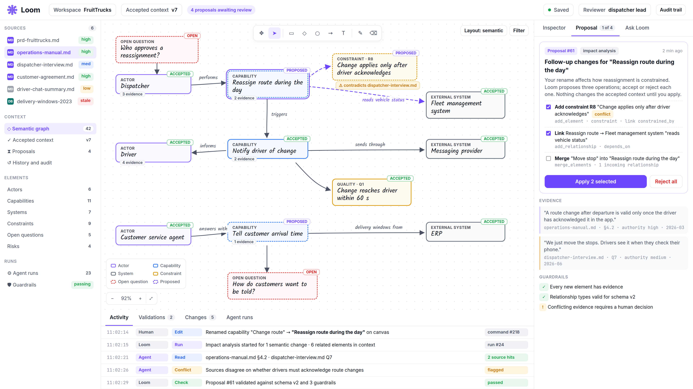

# Session 3 — Giving Loom knowledge it can explain

This reader explains why Loom needs different kinds of information, how an agent should use that information, and what the four workshops contribute. Read it before the session to get your bearings, and return to it afterwards to connect the exercises with the larger picture. The practical steps are in the [workshop guide](WORKSHOP.md).

## What are we trying to achieve?

The aim of the campus is to develop a team that can **design and implement an agentic application**: software in which AI can interpret a task, use information and choose from the actions the application provides.

Building that software means making decisions about what the AI can see, what it may do, how its work is checked and when a person must decide. It also means recognising when the available information cannot support a useful answer. Your team needs to turn these choices into behaviour that others can inspect and maintain.

We practise those skills by building **Loom**. Each session adds a working part of the product and a design lesson that you can use elsewhere. Session 3 asks how an agent can answer a question from several sources while showing where its answer came from and what remains uncertain.

## What is Loom?

Loom is an engineering workspace that helps a team turn source material into a shared, reviewed understanding of a software solution.

A project begins with more than one brief. There may be operational documents, interviews, agreements, spreadsheets and facts held in existing systems. Some information changes slowly; some can change while you are discussing it. Sources may describe the same subject differently or disagree outright.

Loom's AI can help find and interpret relevant information, explain connections and bring unanswered questions to the team's attention. People review that work and decide what belongs in the team's agreed understanding. As the product develops, this understanding can support design, engineering documents and software.

The team needs to be able to ask: **What information supports this answer, how current is it, and what might change our conclusion?** Session 3 makes those questions visible in a working application.

*A design mock-up of the larger Loom workspace. The sources on the left and evidence on the right help explain why access to knowledge is a foundation for the shared understanding in the centre. This illustrates the product direction; it is not a screenshot of the Session 3 application.*

### Where does FruitTrucks fit?

FruitTrucks is the fictional business we use throughout the campus. It distributes fresh produce and wants better coordination of deliveries. Understanding its needs involves knowing what people say should happen, what its recorded facts show and what is happening in its fleet now.

**Loom is the engineering application we build. The delivery application is the solution that Loom helps us understand and design.** We use FruitTrucks' documents and simulated systems to practise knowledge access in Loom. The fleet information is supplied by a local simulation, so the exercises do not depend on a real fleet service.

## What does Session 3 contribute?

Session 1 established controlled access to a brief and a checked analysis. Session 2 added a durable workflow, recovery and human review. Session 3 adds a separate ability to ask knowledge questions and inspect the evidence behind the answers.

For example, a question about how dispatchers handle a route change belongs with documents and interviews. A question about a driver's recorded licence belongs with exact records. A question about a vehicle's present availability belongs with a source that reports current operational status.

The completed demonstration lets you ask a question and examine the answer alongside quotations, source identities, observation times, conflicts and uncertainty. An answer and its retrieval reports are saved so that you can return to them after restarting the application.

At the end of Session 3, your team should have a working knowledge capability and be able to explain why a source was selected, why some information was refused and why a disagreement remained visible.

## What do we mean by a harness here?

The **harness** is the software around the AI that gives it its task, information, available actions and operating rules, and manages what happens during and after its work.

Imagine asking a colleague whether a vehicle can make a delivery. They might read an operating rule, check a vehicle record and ask for a current status. You would expect them to distinguish a rule from a record and a record from a recent observation. You would also expect them to say when a source was unavailable or two sources disagreed.

The agent needs the equivalent arrangement. GitHub Copilot manages the model interaction and the choice of supplied tools. Loom supplies specific ways to retrieve information, checks whether the returned evidence is eligible and validates the answer before saving it.

A **citation** connects an answer to evidence the agent actually retrieved. **Provenance** tells you where that evidence came from and how it was obtained. Neither replaces judgement about the meaning of the answer. A real quotation can still be misunderstood or used to support a conclusion that needs further review.

## Why these four workshops?

The four workshops follow the path from **finding the right facts**, through **judging the evidence and preserving disagreement**, to **connecting a changing source**. Each completes one part of the harness around knowledge access.

### Workshop 1: How do we find the exact record?

The first workshop completes lookups of particular drivers, delivery locations and vehicles. A record may need related information to make sense: a driver's identity and licence, or a delivery location and its customer.

The agent asks for a known kind of record using its identifier. The application supplies the supported lookup and returns readable information with its source and time. This gives the agent a focused action for a factual question.

For the future Loom, this is a foundation for bringing facts from existing systems into engineering discussions. The team can inspect which record was used without giving the agent unrestricted access to the database.

### Workshop 2: Is this evidence suitable to use?

The second workshop completes the checks on a source's authority and the age of its observation. A customer agreement, an informal message and a current fleet observation have different roles. Information that is useful for one question may be unsuitable for another.

Reading an old record today does not make its observation current. A vehicle status that was useful moments ago may need refreshing before an answer is submitted. The application checks evidence when it is retrieved and checks it again when the answer is submitted.

Rejected evidence stays visible in the access report with a reason, while its content is withheld from the successful evidence returned to the agent. If there is no suitable information, the answer should explain the uncertainty.

For the future Loom, these checks help the team understand why a source can support a proposal and when that support needs to be reconsidered. The workshop uses explicit rules; it does not make the application a universal judge of truth.

### Workshop 3: What happens when sources disagree?

The third workshop completes the detection of the disagreements planted in the FruitTrucks material. For example, an agreement and a system record may give different delivery windows. The team needs to see both claims and the evidence behind them.

The application compares the supplied facts and attaches detected conflicts to the answer. It preserves the disagreement so that someone can investigate it. Repeating a claim from one source alone does not establish a disagreement between sources.

For the future Loom, this is a foundation for keeping unresolved questions visible in the shared understanding. Session 3 compares a defined set of facts; understanding every possible disagreement in free-form documents is a broader challenge.

### Workshop 4: How do we use information that changes?

The fourth workshop connects a tool that asks the simulated fleet management system for a particular vehicle's current availability and compartment temperature. The application provides a limited, purpose-specific connection.

A current source can fail, take too long or return an observation that is already too old. Those outcomes must be recorded and explained. The agent should not invent a vehicle status because the service could not answer.

For the future Loom, this introduces the same engineering responsibilities that real external connections will need: clear scope, bounded waiting, evidence about when something was observed and an understandable failure path. The local mock makes these conditions repeatable during learning.

## How the pieces work together

Consider the question: “What delivery window applies to this customer?”

The agent retrieves the agreement and the relevant system record. Loom records the sources and checks their evidence. If the agreement says thirty minutes and the current system record says sixty, the answer can explain both and display the conflict. An outdated export is reported as rejected rather than treated as confirmation of the current record.

For a different question — “Is this vehicle available now?” — the current fleet tool is appropriate. If its observation is stale or the source fails, the answer should make that limit clear. Finding information is only useful when the team can see what it supports.

**A saved knowledge answer is an insight, not a human-approved workflow proposal.** Asking a question does not accept a Session 2 workflow, update a delivery system or add accepted facts to the future Loom solution model. That separation lets people investigate before deciding what to change.

In the larger Loom, these insights can inform later proposals and reviewed changes. The sources, checks and visible uncertainties provide a foundation for explaining why the team accepts something and what new evidence might cause it to reconsider.

## What to take away

After the session, explain to a colleague why one question neeow one rejected source, one disagreement and one answer whose limits are visible. Connect these examples to the four workshops.
ds a document, another an exact record and another a current observation. Sh
Your team is learning to build agentic applications; Loom is the product used to practise those skills; and the harness now supports knowledge access that people can examine. The useful result is an answer accompanied by enough evidence and uncertainty for the team to judge its next step.

For the practical exercises, continue with [WORKSHOP.md](WORKSHOP.md). For the more precise concepts and checks, use [THEORY.md](THEORY.md) and [VALIDATION.md](VALIDATION.md).

## Starting the next session

Each session starts from its supplied full starter in a fresh folder. Earlier reference implementations are included; keep your previous work for comparison. Learner improvements and database history do not transfer automatically. Complete local setup before class using [the session-start guide](../../../SESSION-START.md) and [QUICKSTART](../../../QUICKSTART.md). Carrying selected improvements forward is optional work after class.

## Session 3 local storage

Use this folder’s own `.env.local` and SQLite application file by default; PostgreSQL remains explicit. Follow [SQLite setup](../../../QUICKSTART-SQLITE.md). Earlier tools and workflows are supplied complete. Keep application, test, evaluation and demonstration storage separate, and preserve the same application file when checking restart persistence. Storage selection does not change the four exercises or evidence policy.
